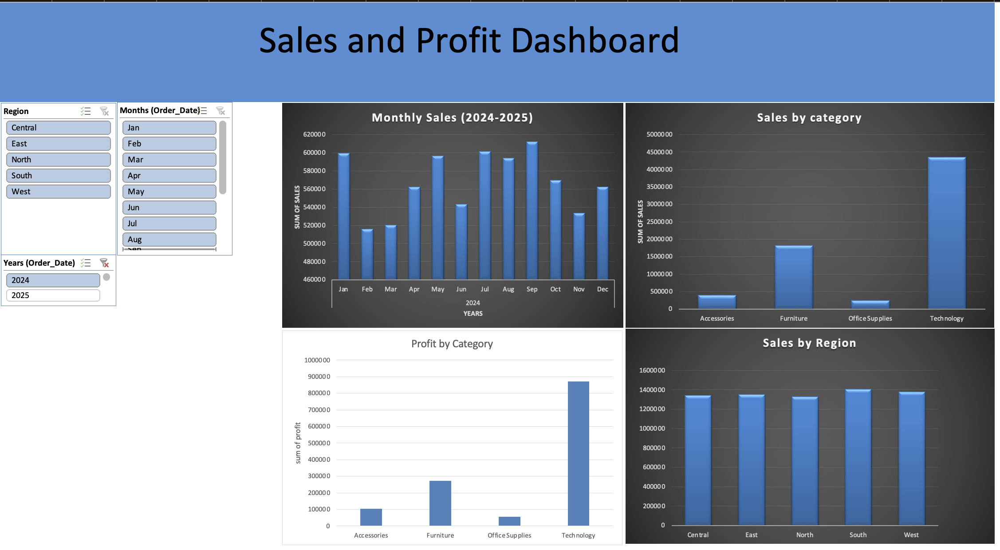

# Sales and Profit Analysis Dashboard

## Project Overview
This project analyzes sales and profit performance using an interactive Excel dashboard. It helps explore trends over time and compare performance across product categories and regions.

## Tools Used
- Microsoft Excel
- PivotTables
- PivotCharts
- Slicers
- Data analysis and visualization

## Dashboard Preview

The dashboard includes:
- Monthly Sales (2024–2025)
- Sales by Category
- Sales by Region
- Profit by Category

Interactive slicers allow users to filter the dashboard by year, month, and region.

## Key Insights
*To be completed after analyzing the results and validating the figures.*

## Skills Demonstrated
- Data summarization and analysis
- Interactive dashboard creation
- Data visualization
- Business performance reporting
